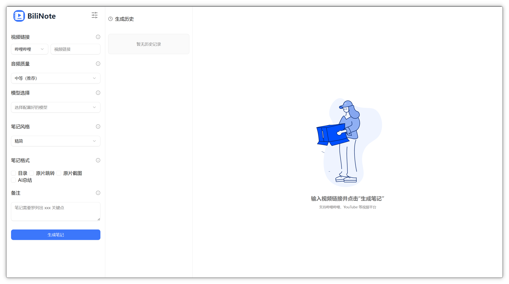
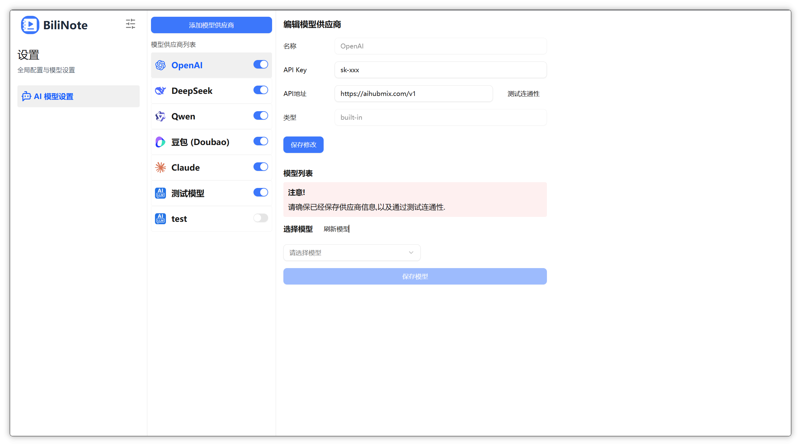
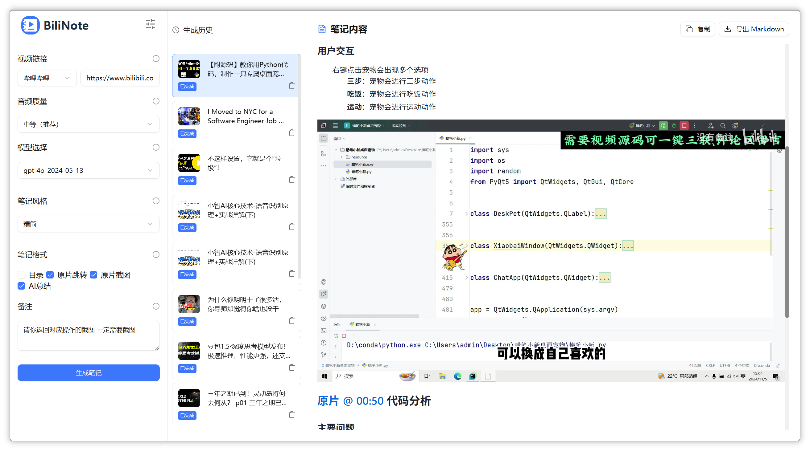
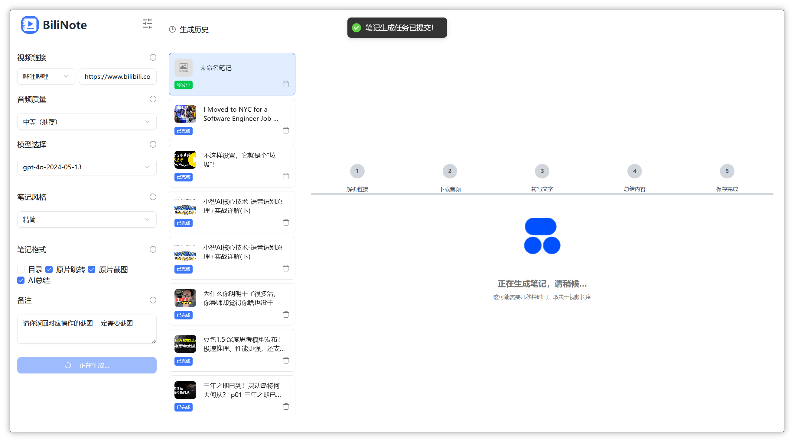
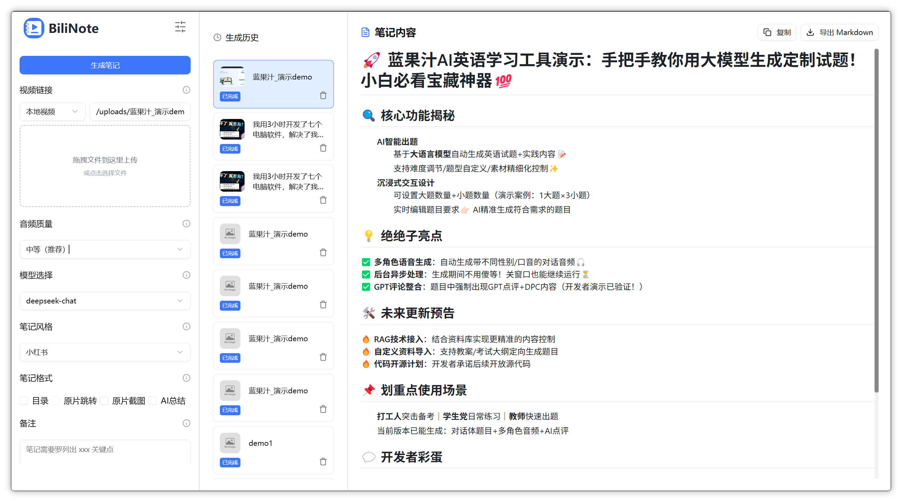

<div style="display: flex; justify-content: center; align-items: center; gap: 10px;
">
    <p align="center">
  
</p>
<h1 align="center" > BiliNote ALTER（二次开发版）</h1>
</div>

<p align="center"><i>AI 视频笔记生成工具 —— 基于开源项目 BiliNote 的增强版本，让 AI 为你的视频做笔记</i></p>

<p align="center">
  
  
  
  
  
</p>

## ✨ 项目简介

本项目基于开源项目 [JefferyHcool/BiliNote](https://github.com/JefferyHcool/BiliNote)（MIT License，v2.4.4）进行二次开发，在保留原有全部能力（多平台链接解析、Whisper 系列本地转写、LLM 结构化笔记、RAG 问答、浏览器插件、桌面客户端等）的基础上，重点补齐了**批量任务管理、存储治理、任务可重试性**等面向长期使用的工程化能力。

> 原项目地址：[https://github.com/JefferyHcool/BiliNote](https://github.com/JefferyHcool/BiliNote) · 使用文档：[docs.bilinote.app](https://docs.bilinote.app/)

## 🚀 二次开发新增功能

### 1. 批量任务管理（批量面板 + 批次分组）

- 批量提交多个视频链接，自动校验平台、预检历史重复（`/batch_check_duplicates`），重复任务二次确认后再创建
- **批次分组**：任务按 `batch_id` / `batch_name` 归组，支持重命名批次、把任务移动到其他批次、从批次中移出
- **暂停 / 继续 / 取消**：批次级控制，控制状态持久化到 `config/batch_controls.json`（`BatchControlStore`），**后端重启后暂停/取消状态不丢失**，不会再被误判为运行中
- **失败任务管理**：批量重试指定失败任务（可切换供应商/模型）、一键清理失败任务

### 2. 存储管理（生成物一览 + 安全清理）

- 新增「设置 → 存储管理」页（`/artifacts` 路由 + `Artifacts.tsx`），按分层展示笔记生成的全部产物：
  - 笔记成品 JSON（前端展示唯一依据，**不可批量清理**，双保险拒绝）
  - Markdown 导出副本（可从 JSON 随时重建）
  - 转录文本 / 状态 / 音频元数据等中间 JSON
  - 视频音频缓存、截图、抽帧、上传文件等纯缓存
- 清理粒度支持目录与 glob 两种模式（`exclude_globs` 防护），防止误删权威数据

### 3. 存储位置可配置（输出目录设置）

- 新增「设置 → 存储位置」页（`/output_config`）：Markdown 导出副本目录可运行时修改，**新任务立即生效、无需重启后端**
- 优先级：设置页配置（`config/output.json`）> 环境变量 `NOTE_OUTPUT_DIR` > 默认目录；配置异常自动回退默认目录，任务永不因目录问题中断
- 输出路径统一锚定到后端目录（`output_paths.py`），无论从仓库根目录还是 `backend/` 启动，落盘位置一致

### 4. 可重试任务状态（RETRYABLE）

- 新增 `RETRYABLE` 任务状态：连接中断、Broken pipe、超时、目标不可达等**瞬时网络错误**不再一律判死，前端展示「连接中断，可重试」并支持一键重试
- 错误分类函数 `_is_retryable_error()` 覆盖 httpx / requests 传输层与常见 `errno`，403 等 HTTP 业务错误不在此列
- **后端重启自动恢复卡住任务**：启动时把 TRANSCRIBING / SUMMARIZING / FORMATTING / SAVING 等中间状态统一标记为 RETRYABLE，避免「永远卡在半路」

### 5. OpenAI 客户端显式超时

- 默认请求超时 180s（原 SDK 默认 600s，配合重试单任务最多挂 30 分钟），可用环境变量 `OPENAI_TIMEOUT_SECONDS` 覆盖
- 防止 provider 不响应时任务挂起数十分钟

### 6. 供应商启停守卫

- 供应商新增 `enabled` 开关；提交任务时同步拦截已停用的供应商（`_validate_provider_enabled`），立即给出可用模型列表，而不是等任务跑到后台才失败
- 支持删除供应商（`/delete_provider`）

### 7. 笔记标题批量修复

- 新增「设置 → 手动功能 → 按标题重命名」：把占位标题（为空 / 等于视频 ID / 等于来源链接）统一重命名为视频标题
- 本地缓存缺失标题时**在线补取**（仅取标题不下视频），并同步回笔记 JSON 与历史卡片；抖音 Cookie 失效给出明确提示

### 8. 生成物展示开关

- 笔记封面 Banner 展示开关（历史列表 + 笔记页顶部），关闭后仅显示文字信息

### 9. UI 重构

- 布局重构（RootLayout / HomeLayout / SettingLayout），设置页菜单重组（批量任务、存储位置、手动功能、存储管理独立成页）
- 新增分页组件、i18n 基础架构

### 10. 抖音主页追更（命令行工具）

关注某个抖音博主后，无需再手动逐个贴链接 —— 一次抓取主页全部作品，与已有笔记比对，把**还没生成笔记的新视频**批量补上，并直接归入指定项目。

```bash
# 预览：只抓取与比对，不创建任何任务（默认 dry-run）
python backend/scripts/sync_douyin_profile_notes.py \
    --url "https://www.douyin.com/user/MS4wLjABAAAA..." \
    --project "后期钉 杰瑞"

# 确认无误后真正提交
python backend/scripts/sync_douyin_profile_notes.py \
    --url "https://www.douyin.com/user/MS4wLjABAAAA..." \
    --project "后期钉 杰瑞" --apply
```

常用参数：`--style`（笔记风格，默认 `detailed` 详细）、`--provider-id` / `--model-name`（默认取当前启用的模型）、`--scope-project`（只把指定项目内的笔记视为已生成，默认按全库比对）、`--max-submit`（单次提交上限，配合 `--newest-first` 优先补最新，用于大批量补更时控制队列压力）、`--refresh`（忽略缓存强制重抓主页）、`--base-url`（后端地址）。

- **判定口径与后端一致**：同一个视频只要存在一条**带笔记结果**的任务就算已生成；失败/取消且无结果的不算数，会被重新生成
- **不新建项目**：项目名写错会直接报错并列出所有现有项目，避免拼错名字创建出脏数据
- **失败即报错**：Cookie 失效、后端未启动、模型不可用都会给出明确提示，而不是静默创建一个必然失败的任务
- **可重复执行**：已生成的自动跳过，跑完一批再跑一次即可继续补下一批；补更老账号（作品上千）时建议配合 `--max-submit` 分批
- **自带抓取缓存（默认 30 分钟）**：抓一个千条作品的账号需要约 50 次翻页请求，缓存能显著降低触发风控的概率；抓取失败时会自动降级使用历史缓存继续比对，需要最新数据时加 `--refresh`
- **遇到 403 属正常风控**：抖音对「作品列表」接口有频率限制。短时间反复抓同一个主页会触发 IP 级限流，等 10~30 分钟即恢复（判断方法：换一个主页若也 403，就是限流而非 Cookie 问题）；工具会把这层含义直接提示出来
- 前置条件：后端已启动、已配置有效的抖音 Cookie、目标项目已存在（如需新建请先在前端新建）

## 🔧 原有功能（继承上游）

- 支持多平台：Bilibili、YouTube、本地视频、抖音、快手
- 笔记格式 / 风格选择、多模态视频理解、多版本记录保留
- 自行配置 GPT 大模型（OpenAI、DeepSeek、Qwen 等）
- 本地模型音频转写（Fast-Whisper、MLX-Whisper、Groq、BCut）
- 自动生成结构化 Markdown 笔记；可选插入截图、原片跳转链接
- 任务记录与历史回看；基于 RAG 的笔记 AI 问答（Function Calling）
- 浏览器插件（Chrome / Edge / Firefox MV3）
- 全局代理、转写模型就绪门禁、Docker GPU 加速部署

## 📸 截图预览







## 🚀 快速开始

### 方式一：Docker 部署（推荐）

```bash
docker-compose up --build -d

# GPU 加速部署（需要 NVIDIA GPU + NVIDIA Container Toolkit）
docker-compose -f docker-compose.gpu.yml up --build -d
```

访问：`http://localhost`

### 方式二：源码部署

#### 1. 克隆仓库

```bash
git clone https://github.com/iniEvo/bilinote_alter.git
cd BiliNote
cp .env.example .env
```

#### 2. 启动后端（FastAPI，Python 3.11+）

```bash
cd backend
pip install -r requirements.txt
python main.py          # 监听 0.0.0.0:8483
```

说明：Markdown 笔记默认写到 `backend/note_results`，任务结果 / 转写 / 状态等 JSON 写到 `backend/json_results`（由 `.env` 的 `NOTE_OUTPUT_DIR` / `JSON_OUTPUT_DIR` 控制）；也可在「设置 → 存储位置」页运行时修改。

#### 3. 启动前端（Vite + React 19）

```bash
cd BillNote_frontend
pnpm install
pnpm dev                # 开发服务器 3015 端口，/api 代理到后端
```

访问：`http://localhost:3015`

#### 浏览器插件（可选）

```bash
cd BillNote_extension
pnpm install
pnpm build              # 产物在 ./extension/
```

在 `chrome://extensions/` 加载已解压的 `BillNote_extension/extension/` 目录即可；后端地址在插件设置页配置（默认 `http://localhost:8483`）。

## ⚙️ 依赖说明

- **FFmpeg**：音频处理与转码必需，源码部署请先安装（macOS: `brew install ffmpeg`；Ubuntu/Debian: `sudo apt install ffmpeg`）；Docker 部署已内置
- **CUDA / GPU 加速（可选）**：Faster Whisper 转写可用 NVIDIA GPU，见上游文档（`docker-compose.gpu.yml` + NVIDIA Container Toolkit）
- **LLM API Key**：不要写入 `.env`，从「设置 → AI 模型设置」页面录入，保存到 SQLite 数据库持久化

## 🧠 后续规划

- [x] 批量任务管理（分组 / 暂停 / 重试 / 清理）
- [x] 存储管理（产物一览 + 安全清理）
- [x] 存储位置运行时配置
- [x] 任务可重试性（RETRYABLE）
- [x] 供应商启停守卫
- [ ] 笔记导出为 PDF / Word / Notion
- [ ] 批量任务并发数与调度策略可配置

## 📜 License

MIT License — 本仓库为上游 [JefferyHcool/BiliNote](https://github.com/JefferyHcool/BiliNote)（MIT）的二次开发，遵守原协议，版权归原作者与贡献者所有。

参考致谢：抖音下载功能部分代码参考自 [Evil0ctal/Douyin_TikTok_Download_API](https://github.com/Evil0ctal/Douyin_TikTok_Download_API)。

---

💬 欢迎使用、提 issue、PR ⭐️